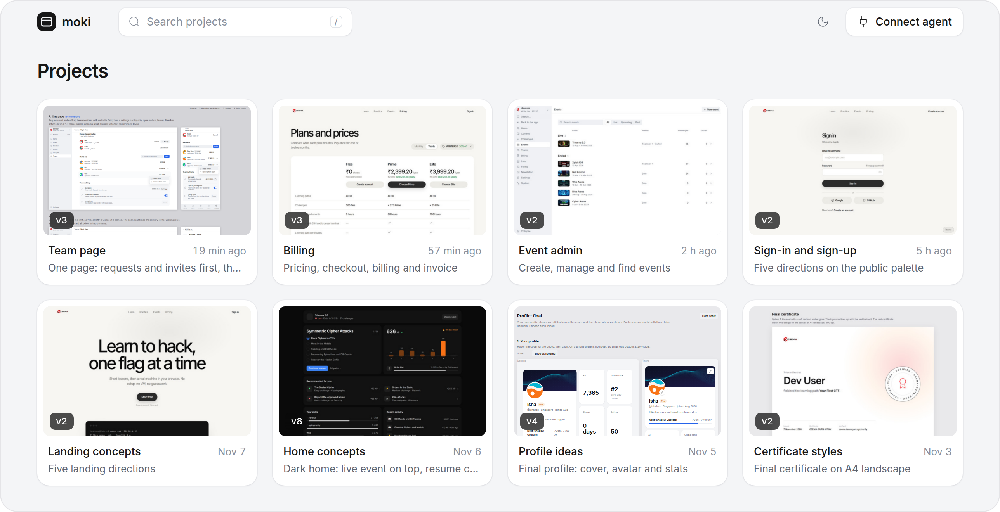
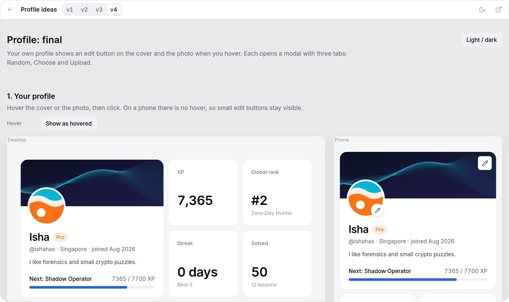

<p align="center">
  <picture>
    <source media="(prefers-color-scheme: dark)" srcset=".github/assets/logo-dark.svg">
    
  </picture>
</p>

<h1 align="center">moki</h1>

<p align="center">
  A home for the UI mockups your coding agent makes.<br>
  Review each version in your browser, before the agent writes the real code.
</p>

<p align="center">
  <a href="#install">Install</a> ·
  <a href="#connect-an-agent">Connect an agent</a> ·
  <a href="#use-it">Use it</a>
</p>

<br>

<p align="center">
  
</p>

## Why moki

- **Mockup first.** Your agent shows you the screen before it touches the real code.
- **Every round is a version.** Step through v1, v2 and v3 and compare them at the same scroll spot.
- **Live.** The page updates the moment the agent uploads.
- **Agents check their own work.** They screenshot each version, and remember your feedback per project.
- **Any agent.** Claude Code, Codex, Cursor, OpenCode, Antigravity, or any tool that speaks MCP.

## Install

### Docker

Runs moki in the background and keeps your projects in the `moki` volume.

```sh
docker run -d --name moki -p 9999:9999 -v moki:/data ghcr.io/tanmoysrt/moki
```

Open http://localhost:9999.

### Install script (macOS and Linux)

```sh
curl -fsSL https://raw.githubusercontent.com/tanmoysrt/moki/develop/install.sh | sh
moki --bg
```

Open http://127.0.0.1:9999. Screenshots need Chrome or Chromium on the machine.

## Connect an agent

Click **Connect agent** in moki, copy the text, and paste it into your agent's chat. It connects the agent to moki and teaches it to make a mockup first.

With Docker, or when moki runs on another machine, run this where moki runs and paste what it prints:

```sh
moki token register                        # macOS and Linux
docker exec moki moki token register       # Docker
```

## Use it

Ask your agent for a mockup:

> Mock up a profile page with a cover, an avatar and stats. Show desktop and phone.

The agent uploads it to moki and sends you the link. Tell it what you think, and the next round arrives as a new version.

<p align="center">
  
</p>

<kbd>←</kbd> <kbd>→</kbd> step versions · <kbd>Esc</kbd> back to projects · <kbd>/</kbd> search

<details>
<summary><b>Commands</b></summary>

<br>

```
moki [flags]                 start moki
moki --bg                    start moki in the background
moki token register          make a token and print the text for your agent
moki token list              list the tokens
moki token revoke <name>     revoke a token
moki help [command]          show the help of a command
```

</details>

<details>
<summary><b>Flags and environment</b></summary>

<br>

| Flag | Env | Default | |
|---|---|---|---|
| `--host` | `MOKI_HOST` | `127.0.0.1` | host to listen on |
| `--port` | `MOKI_PORT` | `9999` | port to listen on |
| `--dir` | `MOKI_HOME` | `~/.moki` | where projects live |
| `--username` | `MOKI_USERNAME` | | basic auth username |
| `--password` | `MOKI_PASSWORD` | | basic auth password |
| `--url` | `MOKI_URL` | from host and port | the URL agents use to reach moki |
| `--bg` | | | run in the background |

With Docker, pass them as env vars: `-e MOKI_USERNAME=me -e TZ=Europe/Berlin`.

</details>

<details>
<summary><b>Run on a server</b></summary>

<br>

```sh
MOKI_USERNAME=me MOKI_PASSWORD=secret moki --host 0.0.0.0 --url http://devbox:9999
```

- Set a username and a password whenever moki listens beyond your machine.
- Set `--url` to the address your agents use, so `moki token register` points there.
- moki speaks plain HTTP. Put it behind a TLS proxy before it leaves your network.

</details>

## License

[Apache 2.0](LICENSE)
